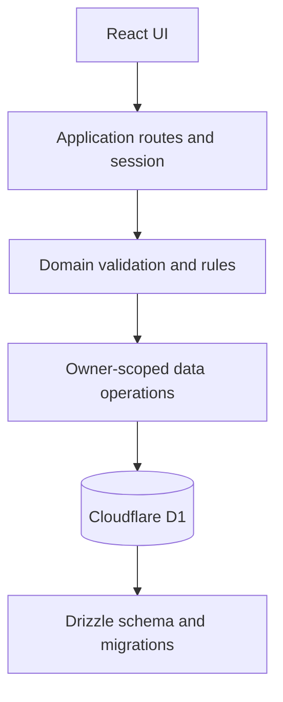

# LifeHub

A personal workspace for tasks, notes, calendar planning and everyday finances, built with React and TypeScript.

LifeHub brings daily planning and personal finance workflows into one responsive application. The current public source edition is adapted for Cloudflare Workers and D1 through ChatGPT Sites.

## Product capabilities

- Tasks with due dates, priorities and completion state.
- Day, week and month calendar views, including recurring events.
- Notes, income and expense tracking, monthly totals and budgets.
- Account balances, transfers, planned subscriptions and a wishlist.
- Configurable themes, accent colors, typography, density and dashboard layout.
- JSON backup/import and CSV export.
- Progressive Web App assets and an offline connection screen.

## Engineering highlights

- **Owner-scoped data access:** server operations associate records with the active owner rather than trusting client-supplied ownership.
- **Input validation:** imported backup data is checked before it is accepted.
- **Conflict detection:** version checks identify stale edits instead of silently overwriting newer data.
- **Safer exports:** CSV output accounts for spreadsheet formula injection.
- **Regression tests:** automated tests cover domain rules, imports, owner isolation, stale updates and transport failures.

## Technology

React · TypeScript · Tailwind CSS · Vinext/Vite · Cloudflare Workers · D1 · Drizzle

The earlier Supabase edition is separate. This public edition uses Cloudflare D1, not PostgreSQL.

## Architecture



Repository layout:

| Directory | Responsibility |
| --- | --- |
| `app/` | Routes, application shell and session endpoint |
| `components/`, `hooks/` | UI components and client state |
| `lib/` | Domain rules, storage and server operations |
| `db/`, `drizzle/` | D1 schema and migrations |
| `tests/` | Domain, server and transport regression tests |
| `build/`, `scripts/` | Sites/Workers integration and local tooling |

## Run locally

**Requirements:** Node.js 22.13+ and npm. The repository checks use Node.js 24.

```sh
npm ci
npm run dev
```

Open [http://localhost:5173](http://localhost:5173).

The local preview provides a development-only sign-in identity. Data features require applying `drizzle/0000_thick_moonstone.sql` to the local `DB` binding with Wrangler and the generated Worker configuration. Use `--local`; do not point tests at a production database.

## Automated checks

```sh
node --test tests/*.test.cjs
npx tsc --noEmit
npm run build
```

The repository currently documents 25 automated checks. Run the commands above against your checkout to verify its current state.

## Deployment and limitations

The author's live deployment is private. This repository does not provide access to it and does not include personal records, credentials, backups or the original Site identity. To deploy your own instance, register a Site and configure its database and authentication.

Known limitations:

- Private data is not cached for offline use; there is no offline write queue.
- Conflicting edits are detected but not automatically merged.
- Subscriptions are reminders, not automatic charges.
- Marking a wishlist item as bought does not create a financial transaction.
- Physical iPhone installation and standalone authentication require device testing.

This is a portfolio project, not a claim of a production deployment. Third-party plugin and asset notices remain with their source files.
